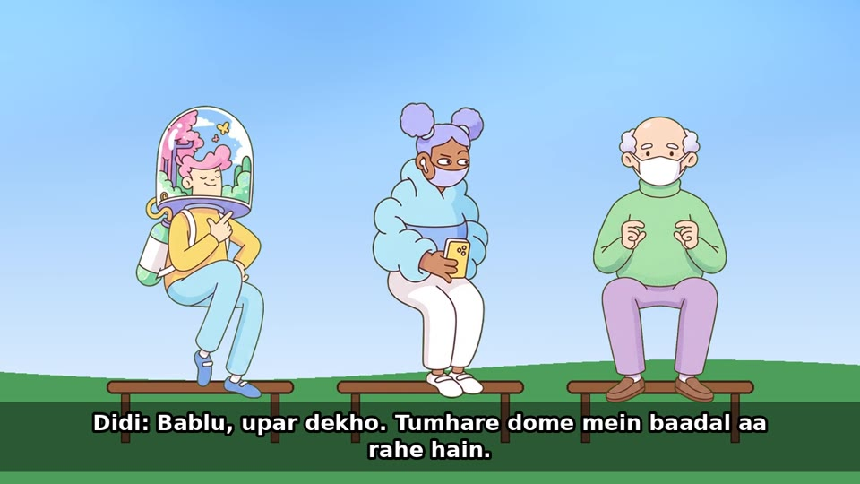

<div align="center">

# 🎬 vid-liboom

**One script in, a whole cartoon episode out.**


</div>

---

## ✨ What is vid-liboom?

vid-liboom is an animation pipeline that turns a written script into a finished, narrated cartoon video. It brings together the tools from the author's other projects into one place:

- **Rigged AI-art characters** that actually move, not flat vector art
- **Procedural shader backgrounds** for weather, sky and mood
- **Voice-over** generated from the script, with lip-sync timing
- **Code-generated music** and sound effects
- **Auto subtitles** in Hindi, Hinglish or English

## 🧭 How it works

```
script.md  ──►  scene planner  ──►  characters + backgrounds  ──►  voice + music  ──►  render  ──►  episode.mp4
```

1. **Write** a script with scenes, dialogue and stage directions.
2. **Plan**: each scene is broken into shots, poses and camera moves.
3. **Draw**: rigged characters are posed over shader-rendered backgrounds.
4. **Voice**: dialogue becomes speech, and mouths sync to it.
5. **Score**: music and effects are generated to match the mood.
6. **Render**: everything is composited into one video with subtitles.

## 🚀 Quick start

```bash
pip install -e .                  # needs ffmpeg on PATH
export CARTESIA_API_KEY=...       # optional, for voices
vidliboom examples/bablu_mausam.md -o output/episode.mp4 --voice
vidliboom examples/bablu_mausam.md -o output/reel.mp4 --voice --format vertical
```



Script format ([full guide](docs/SCRIPT_FORMAT.md)):

```markdown
# Bablu aur Personal Mausam
## Scene: Park ki bench | bg=sky | mood=day
BABLU [proud]: Aaj toh mausam ekdum mast hai!
DIDI [sideeye]: Upar dekho, baadal aa rahe hain.
```

## 🧰 Features

| Feature | What it does |
|---|---|
| 🎭 Pose library | AI-art cut-outs per pose (`BABLU [wave]: ...`), with Bablu, Didi and Uncle included |
| 🗣️ Voices | Cartesia text-to-speech per character, cached per line, timing driven by real audio length |
| 👄 Talk motion | Characters bounce and tilt with the loudness of their own voice |
| 🌦️ Mood backgrounds | Procedural day, sunset, night (twinkling stars) and rain skies |
| 🎵 Music | Mood-matched chord pads generated in code, ducked under dialogue |
| 🎥 Camera | Smooth zoom toward whoever is speaking (`--no-camera` to turn off) |
| 🌗 Transitions | Fade through black between scenes and at the end |
| 📱 Formats | `landscape` 16:9, `vertical` 9:16 for Reels and Shorts, `square` 1:1 |
| 💬 Subtitles | Burned in on a soft bar, plus an `.srt` file next to the video |
| 🤖 Agent skill | [`skills/vid-liboom/SKILL.md`](skills/vid-liboom/SKILL.md) teaches AI agents to make episodes |

## 📁 Project layout

```
vidliboom/        script parser, planner, voice, music, backgrounds, characters, render
assets/characters character pose PNGs (BABLU, DIDI, UNCLE)
examples/         sample scripts
docs/             script format guide
skills/           agent skill
tests/            pytest suite (runs on GitHub Actions)
voices.json       speaker to Cartesia voice map
```

## 🗺️ Roadmap

| # | Milestone | Status |
|---|-----------|--------|
| 1 | Script-to-episode pipeline | ✅ v0.2: poses, voices, music, camera, formats, subtitles |
| 1b | True lip-sync and blinks | 🚧 Next up |
| 2 | Interactive dental explainers | 📝 Planned |
| 3 | Playable mini-games after each episode | 📝 Planned |
| 4 | Personalised videos from one template | 📝 Planned |
| 5 | Beat-synced music visuals | 📝 Planned |
| 6 | Still illustration to animation | 📝 Planned |

## 🎞️ Built with vid-liboom

- **Bablu ki Metro**: a short cartoon about a city metro ride
- **Personal Mausam**: Bablu and his very own weather
- **Midline Diastema**: a dental explainer for patients

## 🔗 Related projects

- [vid-shark](https://github.com/swapagrawal14/vid-shark)
- [Hark-sites](https://github.com/swapagrawal14/Hark-sites)

## 👩‍⚕️ Author

**Swapnil Agrawal**, author, AI researcher and dentist.
GitHub: [@swapagrawal14](https://github.com/swapagrawal14)

## 📄 License

Released under the [MIT License](LICENSE).
